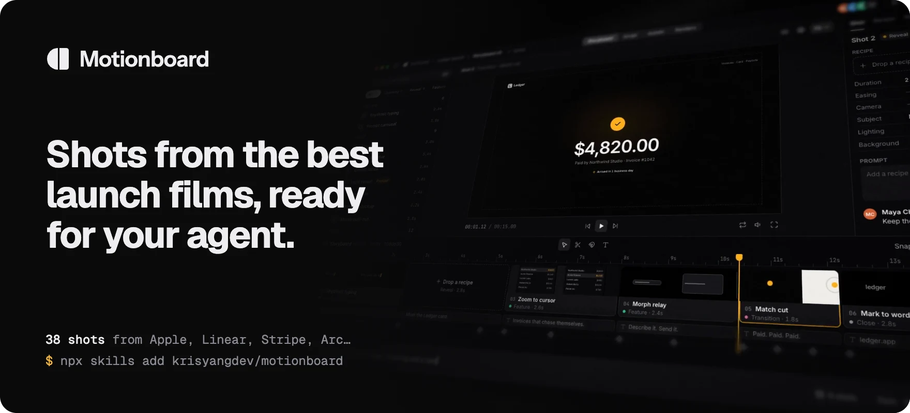
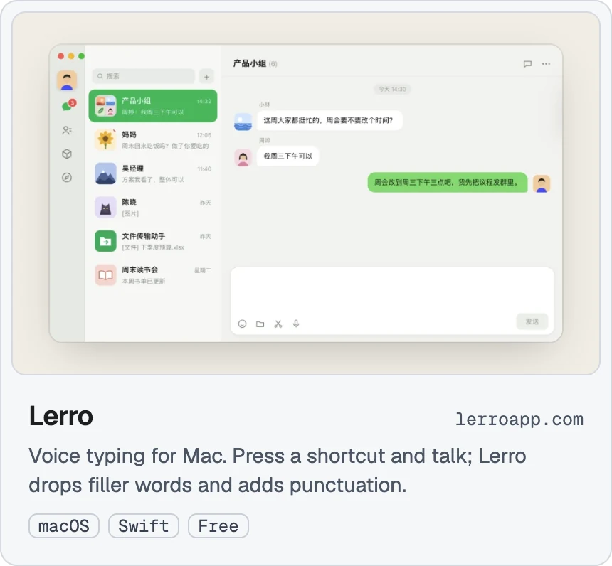
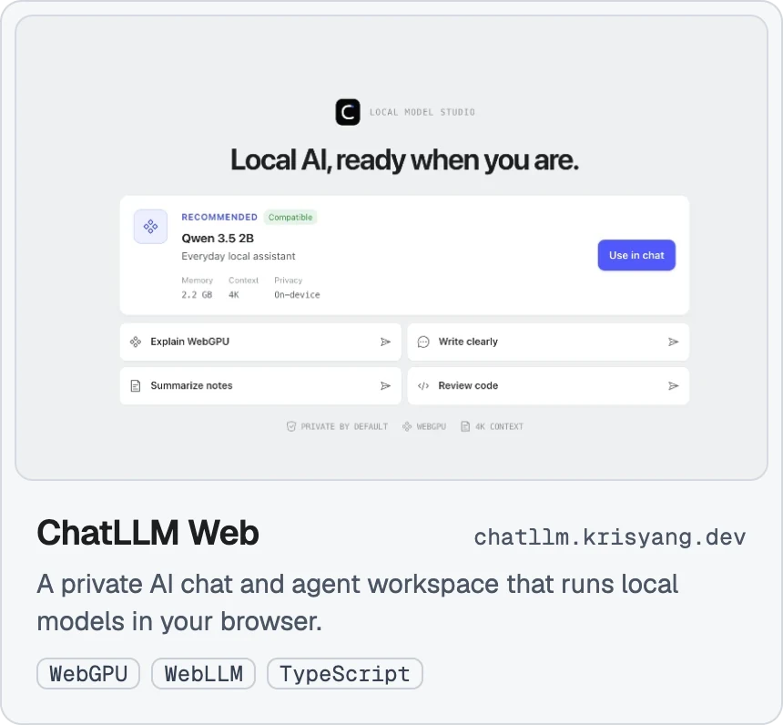

I'm Kris Yang, an independent developer in Shanghai. I make web games, shaders and motion with AI agents, and share the workflows.

[krisyang.dev](https://krisyang.dev) · [X @krisyangdev](https://x.com/krisyangdev) · [ruiyang0012@gmail.com](mailto:ruiyang0012@gmail.com)

<a href="https://github.com/krisyangdev/motionboard"><picture><source media="(prefers-color-scheme: dark)" srcset="assets/motionboard-dark.webp"></picture></a>

  <a href="https://github.com/krisyangdev/lerro"><picture><source media="(prefers-color-scheme: dark)" srcset="assets/lerro-dark.webp"></picture></a>&nbsp;&nbsp;
  <a href="https://github.com/krisyangdev/ChatLLM-Web"><picture><source media="(prefers-color-scheme: dark)" srcset="assets/chatllm-dark.webp"></picture></a>

